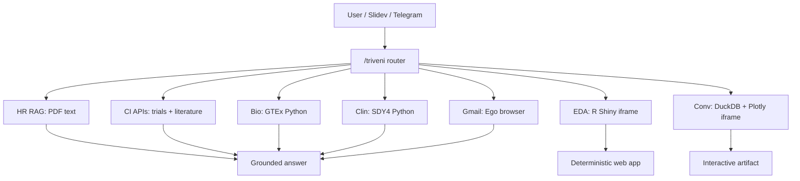

# Bridging Biology, Computation, and AI

## From bioinformatics to agentic AI coding

Zhaojie Zhang, 10/7/2026

---

# Outline

- Educational background and work experience
  - Career Arc: Wet-lab biology, computational genomics, and translational/clinical data science

- Agentic AI coding
  - Beyond vibe coding
  - Live interactive prototype demonstration: cross-functional agents in action
  - Pragmatic realities: trade-offs and prerequisites

---

# Career arc: biology + computation + clinical translation

## Foundation
- University of Colorado at Boulder
- PhD in Biology: genomics, microRNA's roles in epidermis and hair follicle development
- MS in Computer Science: Machine Learning, databases, Natural Language Processing, cloud, etc.
- Wet-lab + dry-lab fluency

---

# St. Jude: clinical genomics at diagnostic scale, 2013–2016

- Data scientist for Genomes for Kids, spanning pediatric hematologic malignancies, solid tumors, and brain tumors
- Built pipelines for SNVs, indels, CNVs, and SVs from WGS/WES/RNA-seq
- Partnered with sequencing labs, pathologists, genetic counselors, and tumor boards

---

# H3 Biomedicine / Novartis / Moderna, 2016-2025

## H3 Biomedicine
**Senior Investigator / Investigator II, Data Science and Biomarkers**

- Biomarker and data science lead for ER+/HER2- breast cancer

## Novartis
**Associate Director, Data Science, Global Drug Development**

- Biomarker biostatistics for Phase I–III trials

## Moderna
**Director, Oncology Clinical & Translational Bioinformatics**

- Translational strategy for individualized neoantigen therapy

## Through-line
- Omics and biomarker data
- Statistics, causal inference and AI/ML
- Translational Research and Clinical Development

---

# Experience in different R&D stages

---

# BeOne Medicines: AI-enabled workflows, 2025–Present

## Director, Data Insights
- Train broader teams on data, databases, ML, and agentic AI
- Drive AI initiatives for analytics, visualization, and workflow automation

## Selected projects
- AI-enabled data visualization
   - Medical Data Review Dashboard redesign using AI coding
   - AI/BI dashboard in DataBricks
- Self-service reporting tools
   - Background rate generation of adverse events using Symphony Claims data for pharmacovigilance
- Workflow automation for recurring data tasks
   - Specification-driven Data Management tasks automation

---

# Why agentic AI coding now?

## Noise
- Generic chatbots without grounding
- Demos that cannot touch real workflows
- Models that hallucinate, miscalculate, or go stale

## Signal
- RAG over trusted documents
- API/function/tool execution
- Reproducible coding workflows
- Human-reviewed automation for R&D decisions

---

# Triveni concept

## Not a chatbot — an extensible operating system for decisions

Triveni pairs scientific strategy with executable agent capabilities:

1. **Ground** answers in curated sources
2. **Act** through APIs, code, databases, and analysis tools
3. **Structure** outputs into reusable artifacts
4. **Surface** uncertainties and caveats

---

# Scientific anchor for the demo

## Triveni strategy context
- Genetics-informed targets in epithelial barrier disease: **KLK5/7**, **PRSS1**, and related protease biology
- Research & Development: lesion biopsies, biomarkers, patient cohorts, and clinical readouts
- Operations: based on company-specific documents

---

# Use case 1: People operations

## AI dimension
Grounded RAG and policy retrieval

## Scenario
Answer questions over the local employee benefits memo without hallucinating.

## What Triveni-agent executes
- Extracts and caches the benefits memo PDF with `pdftotext`
- Retrieves query-specific passages with keyword matching
- Returns “nothing found” when no specific passage matches
- Keeps supported answers short and quotes memo text

<TriveniAgent title="/triveni-hr" prompt="/triveni-hr frame reimbursement policy" />

---

# Use case 2: Competitive intelligence

## AI dimension
Autonomous surveillance and competitive synthesis

## Scenario
Track competitor clinical reads and patent filings in atopic dermatitis / epithelial barrier disease.

## What Triveni-agent executes
- Calls ClinicalTrials.gov, Europe PMC, bioRxiv, and ChEMBL APIs
- Uses flexible query terms and records exact terms used
- Links targets to known assets and drug names to ChEMBL targets
- Returns fixed-width trial/literature/preprint tables with caveats

<TriveniAgent title="/triveni-ci" prompt="/triveni-ci KLK5 in atopic dermatitis" />

---

# Use case 3: Biology and translational science

## AI dimension
Multi-modal data harmonization and EDA

## Scenario
Explore GTEx tissue expression for related biomarkers.

## What Triveni-agent executes
- Parses natural-language GTEx gene/tissue requests
- Runs Python / pandas on GTEx median TPM data
- Generates bar/scatter plots, TUI text plots, CSVs, and PNGs
- Supports top-expression, co-expression, and correlation queries

<TriveniAgent title="/triveni-bio" prompt="/triveni-bio box plot of KLK5 and KLK7 expressions in skin and brain tissues" />

---

# Use case 4: Exploratory analysis of clinical data

## AI dimension
Clinical data exploration with guardrails

## Scenario
Explore ImmPort SDY4 atopic dermatitis / eczema herpeticum labs against healthy controls.

## What Triveni-agent executes
- Loads ImmPort SDY4 AD / eczema herpeticum lab tables
- Compares all AD arms vs healthy controls for requested measures
- Reports means, differences, SMDs, Welch p-values, and BH-FDR
- Filters to increased or decreased markers when requested

<TriveniAgent title="/triveni-clin" prompt="/triveni-clin all labs increased in eczema vs healthy controls" />

---

# Use case 5: Interactive clinical EDA dashboard

## AI dimension
Natural-language launch into deterministic analytics UI

## Scenario
Move from a `/triveni-clin` text summary into an interactive SDY4 lab dashboard for live review.

## What Triveni-agent executes
- Launches a local R Shiny app from `/triveni-eda`
- Embeds the dashboard directly inside Slidev
- Lets reviewers choose lab measures, plot type, and AD arm grouping
- Keeps raw clinical tables local while showing plots and screening tables

<TriveniEda />

---

# Use case 6: Conversational clinical analytics

## AI dimension
Natural-language analytics backed by deterministic SQL

## Scenario
Ask SDY4 lab questions, inspect DuckDB SQL, and review Plotly charts in the deck.

## What Triveni-agent executes
- Launches `/triveni-conv` as a local Python web app
- Builds a DuckDB table over SDY4 subject-level labs
- Converts common clinical questions into SQL templates
- Renders cohort counts, lab screens, and measure plots with Plotly

<TriveniConv />

---

# Live interaction slide

Triveni agent: conversational intent to validated execution. Showcase triveni agent tool uses, browser use with triveni-assist, and communication with Telegram.

<TriveniAgent title="Live Triveni-agent command" ABC prompt="/triveni" />

---

# Triveni extension architecture

---

# Closing

## The goal is not replacing expertise.

It is to make expertise **faster, more traceable, and more reusable** across the enterprise.

Triveni = grounded reasoning + executable tools + scientific judgment by humans

---

# Decision Matrix: Apps vs. Hybrid vs. Agents

| Dimension | Deterministic Web Apps | Hybrid: Tools + LLM Interface | Autonomous Multi-Step Agents |
|---|---|---|---|
| Primary mechanism | Static, pre-compiled business logic; same code path every run. | Natural-language interface maps intent into pre-defined tool calls. | Dynamic reasoning loops, self-correction, runtime tool chaining, task planning. |
| Output predictability | 100% deterministic. Identical inputs yield identical outputs. | High. Model drafts query/tool args; backend execution is deterministic. | Stochastic. Format and reasoning path can vary between runs. |
| Data sensitivity & privacy | Zero egress risk inside VPC, DuckDB, or lakehouse boundaries. | Controllable. LLM sees metadata/schema; raw records stay local. | Higher governance surface: context may carry sequences, assay, or clinical data. |
| Regulatory & audit traceability | Strong Part 11 fit: fixed code paths, deterministic logs, static tests. | Audit-friendly: intent and generated payloads are logged before execution. | Complex trail: loops, hidden branching, and dynamic context complicate compliance. |
| Workflow flexibility | Rigid: dropdowns, sliders, defined routes. | Semi-flexible: open questions constrained to mapped APIs. | Maximum: open-ended, ambiguous, multi-hop tasks without pre-coded paths. |
| Compute & ops cost | Negligible fixed server/database costs. | Low: usually 1–2 LLM calls plus tool execution. | High and variable: tokens, retries, tool calls, replanning. |

---

# Readiness Matrix: AI Coding & Agentic Workflows

| Layer | Prerequisite metric | Not ready | AI-ready threshold | Triveni action |
|---|---|---|---|---|
| 1. Data structure & schemas | Semantic uniformity and typed schemas | Heterogeneous Excel sheets, merged cells, inconsistent gene names, free-text notes. | Structured JSON/Parquet/relational tables with unique IDs and strict types. | Enforce Pydantic or DuckDB contracts for lab assays and IC50 fits before LLM use. |
| 2. Data access & connectivity | Programmable read APIs | Data trapped in GUIs, vendor portals, ELN systems, or local drives. | Headless REST/GraphQL, object storage, or read-only database replicas. | Mount lakehouse/bucket paths such as S3 or Unity Catalog for programmatic reads. |
| 3. Domain business logic | Deterministic algorithmic baseline | Scientific logic lives in heads or unannotated scripts with hard-coded paths. | Core calculations are unit-tested callable functions. | Refactor biologics triage and biometrics QC into importable Python/R packages. |
| 4. Context & metadata | Curated knowledge stores for RAG | Raw 100-page PDFs without metadata tags or chunk boundaries. | Chunked indexed stores with versioning, dates, and category tags. | Chunk HR policies and SAPs with metadata like `effective_year` and `category`. |
| 5. Evaluation & guardrails | Automated benchmark harness | Manual eyeballing of a few cherry-picked outputs. | Golden test set with programmatic regression scoring. | Build reference antibody and trial-endpoint cases to score agent accuracy. |
| 6. Security & governance | Zero-retention private tenant boundaries | Proprietary sequences, trial designs, or employee data pasted into public LLMs. | Enterprise zero-retention contracts and PII redaction. | Route requests through an enterprise VPC proxy and secure model boundary. |

---

# Thank you for coming!

  
Biology (Domain Knowledge) + Computation (Tools)

  

    
🙂

    

    

  

  
Harness

  
Hooks

  
MCPs

  
AI SDKs

  
Models

  
LLMs

  
AI

  
More AI models

  
Another new model

  
Another new Harness

  
Another AI concept

  
Another AI Jargon

  
New AI jargon

  
New AI model

  
New AI jargon

  
New AI model

  
New AI jargon

  
New AI model

  
Loops

  
Contexts

  
Memory

  
HeartBeat

  
Orchestration

  
Skills

  
Claude

  
GPT

  
Codex

